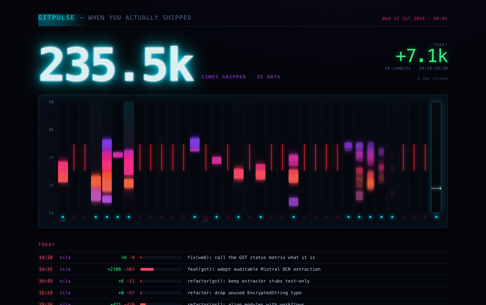

# gitpulse

A local, self-contained picture of when you actually shipped. It reads your
configured git repos and writes one standalone neon HTML dashboard — no server
or dependencies, and no network access unless you pass `--fetch`. It regenerates
on every commit and pops itself open on your screen every evening.



## What you see

- **Hero number** — total lines *shipped* (additions) over the last 35 days, in a
  giant CRT-glow figure. Generated/vendored junk is excluded so it's honest code,
  not lockfile churn.
- **The strip** — 35 vertical columns, one per day, each a full midnight→midnight
  tube. Every commit is a tick at its real time, colored by hour (cyan at night,
  magenta at midday, orange at dusk) and *sized by how many lines it changed*. A
  dense grind day is a stack of fat glowing slabs; a one-liner is a thin tick. A
  gap day is a red glitch slash — impossible to miss.
- **Today** (top right) — the live number: `+lines` shipped today, commit count,
  time span, and your current streak. Today's column carries a pulsing "now" line
  so it reads as still open.
- **Today's log** — every commit from today with time, repo, `+adds −dels`, a
  proportional churn bar, and the message.

## Install

```bash
chmod +x install-gitpulse.sh
./install-gitpulse.sh
```

The installer does four things:

1. Copies the `gitpulse` script to `~/.local/bin/gitpulse`.
2. Writes a global `post-commit` hook (`~/.githooks/post-commit`, wired via
   `core.hooksPath`) so the page regenerates in the background after every commit.
   The hook chains to any repo-local `post-commit` you already have, so nothing
   breaks. If `core.hooksPath` is already set to something else, the installer
   bails with a warning instead of clobbering it.
3. Installs a launchd agent (`~/Library/LaunchAgents/com.gitpulse.nightly.plist`)
   that runs gitpulse and opens the page at **20:45** daily.
4. Runs it once and opens the result.

The page lives at `~/gitpulse.html`.

## Usage

```bash
gitpulse           # regenerate the page, print a one-line summary
gitpulse --fetch   # fetch all remotes and prune, then regenerate
gitpulse --open    # regenerate and open it in your browser
gitpulse --quiet   # regenerate silently, no output (used by the commit hook)
```

`~/.local/bin` must be on your `PATH` for the bare `gitpulse` command to work.

## Configuration

All at the top of the `gitpulse` script:

- `REPOS` — exact local repository paths included in the dashboard. The default
  configuration tracks `nila`, `kaguya`, and `nila-connector`.
- `AUTHOR_EMAILS` — empty by default, which auto-detects your email from git
  config so other people's commits in shared repos don't pollute your numbers.
  Set explicit emails to override.
- `DAYS` — number of day-columns on the strip (default 35).
- `EXCLUDE` — git pathspecs whose line counts are ignored (lockfiles, fixtures,
  snapshots, minified/vendored/generated code) so churn reflects authored work.
  Add a glob here if a generated file in one of your repos is inflating the count.

### Change the nightly time

Edit `Hour` / `Minute` in
`~/Library/LaunchAgents/com.gitpulse.nightly.plist`, then reload:

```bash
launchctl unload ~/Library/LaunchAgents/com.gitpulse.nightly.plist
launchctl load   ~/Library/LaunchAgents/com.gitpulse.nightly.plist
```

## Uninstall

```bash
git config --global --unset core.hooksPath
launchctl unload ~/Library/LaunchAgents/com.gitpulse.nightly.plist
rm ~/Library/LaunchAgents/com.gitpulse.nightly.plist
rm -rf ~/.githooks ~/.local/bin/gitpulse ~/gitpulse.html
```

## Requirements

macOS (uses `launchctl` and `open`), `python3`, and `git`. No Python packages —
standard library only.
</content>
</invoke>
